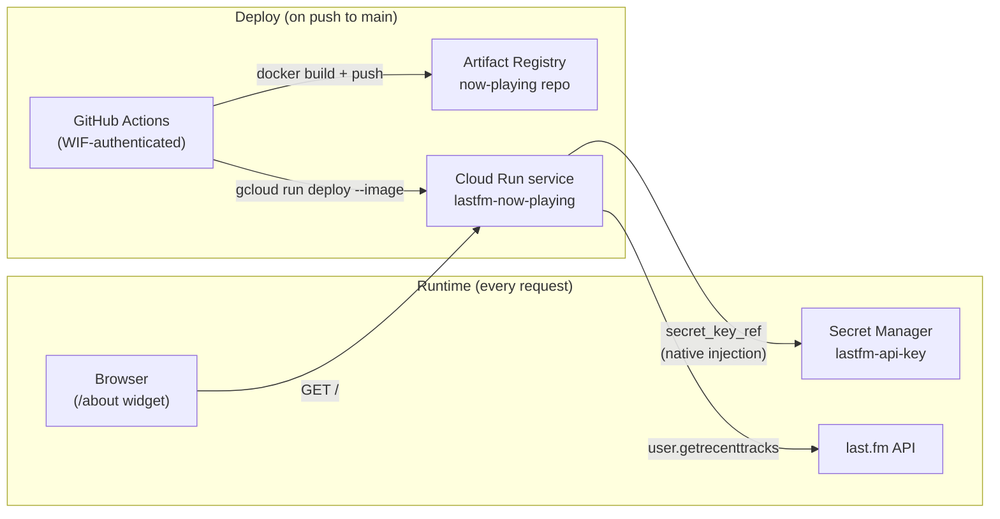

# elliotx-website-apps

Small backend apps that support [elliotx.com](https://elliotx.com), each deployed as its own container on Cloud Run. This repo is meant to hold several of these over time — one folder per app, sharing a common deploy pattern rather than each reinventing it.

The first app here, `last-fm/now-playing`, is documented below in full as a worked example: what it does, how it's built, how it deploys, and how the pieces fit together — so you can either understand it or copy the pattern for something of your own.

## Structure

```
<integration>/<app-name>/     # e.g. last-fm/now-playing/ — one folder per app
.github/
  dependabot.yml                # one npm + docker entry per app, plus github-actions
  workflows/
    deploy-app.yml               # reusable: build, scan, push to GAR, deploy to Cloud Run
    lint-app.yml                 # reusable: format/lint/typecheck/audit
    <app-name>.yml                # thin per-app caller — lint on PR, deploy on push to main
    codeql.yml                   # repo-wide, not per-app
    dependency-review.yml        # repo-wide, not per-app
```

Each app folder is a self-contained Node/TypeScript project with its own `package.json`, `package-lock.json`, and `Dockerfile` — deliberately *not* an npm workspace. That was tried first and reverted: workspaces hoist `node_modules`/the lockfile to the repo root, which breaks a per-app-folder Docker build context. Revisit that decision only once a second app creates a real shared-tooling need.

Infra (GCP resources, IAM) for these apps lives in a **separate** repo, `elliotx-website-terraform`, one subfolder per app — see [Infrastructure](#infrastructure) below.

## Worked example: `last-fm/now-playing`

Returns the currently-playing (or most recently played) track from [last.fm](https://last.fm) as JSON, for the "Now playing" widget on elliotx.com's `/about` page.

```
GET https://lastfm-now-playing-ei7ug2a2za-uw.a.run.app/

{
  "isPlaying": true,
  "track": "Ms. Tundra",
  "artist": "Ne-Yo",
  "album": "Ms. Tundra",
  "albumArt": "https://lastfm-img.freetls.fastly.net/i/u/174s/....jpg",
  "url": "https://www.last.fm/music/Ne-Yo/_/Ms.+Tundra"
}
```

### Why it's a Cloud Run service, not a Cloud Function

The obvious-looking option is a small serverless function. That was actually the first implementation — but it doesn't fit a CI/CD flow where GitHub Actions itself builds and pushes an image: Cloud Functions v2 always rebuilds its own container from source via a hidden, Google-managed Cloud Build pipeline on every deploy, and can't be pointed at an image you already built and pushed yourself.

A plain Cloud Run **service** does exactly that: you build an image anywhere, push it to a registry, and tell Cloud Run "run this." That's the model here — GitHub Actions builds the image and pushes it to Artifact Registry (GAR); Cloud Run just runs whatever image is there.

### Architecture



No long-lived credentials anywhere in this pipeline:

- **GitHub → GCP**: Workload Identity Federation (WIF). GitHub Actions presents its OIDC token; GCP trusts it for this exact repo and exchanges it for short-lived access as a scoped service account. No service account key ever leaves GCP.
- **API key → app**: Cloud Run's native Secret Manager integration mounts the secret as an env var at the *platform* level — the app just reads `process.env.LASTFM_API_KEY` like any other env var. There's no Secret Manager SDK call in the app code, and the key is never in the container image, in git, or in CI logs.

### App code

Plain Node/TypeScript, zero runtime dependencies (Node's built-in `http` and global `fetch` are enough for one route):

- `src/index.ts` — HTTP server, CORS headers (public read-only data — safe to allow any origin), routes `GET /` to the handler.
- `src/lastfm.ts` — calls last.fm's `user.getrecenttracks`, maps the response to the JSON shape above, with a 20s in-memory cache (the endpoint is public and unauthenticated, so a short cache absorbs both last.fm's own rate limits and any burst of visitor traffic).

Environment variables:

| Variable          | Where it comes from                                             | Secret? |
| ------------------ | ----------------------------------------------------------------- | ------- |
| `LASTFM_API_KEY`   | Cloud Run, injected from Secret Manager (`secret_key_ref`)        | Yes     |
| `LASTFM_USERNAME`  | Cloud Run, plain env var (set via Terraform)                      | No — public last.fm data, just kept out of source so it's not hardcoded |
| `PORT`             | Cloud Run sets this automatically                                  | —       |

### Dockerfile

Two-stage build — `npm install && npm run build` (tsc) in a `node:24-slim` (Active LTS) builder stage, then just the compiled `dist/` copied into a [distroless](https://github.com/GoogleContainerTools/distroless) `nodejs24-debian12:nonroot` runtime stage: no npm, no shell, no package manager, runs as a non-root UID. Not just smaller — `node:24-slim` still bundles npm (and npm's own dependencies) whether or not the final stage ever runs it, so a container scanner will keep flagging CVEs in files that are never actually used at runtime.

### CI/CD

- **`.github/workflows/deploy-app.yml`** — reusable (`workflow_call`), parameterized by app path, service name, region, GAR repo, WIF provider, and deploy service account. Authenticates via WIF, builds the image, scans it (Trivy — see below), pushes to GAR, then `gcloud run deploy --image=...`.
- **`.github/workflows/last-fm-now-playing.yml`** — a thin caller, path-filtered to `last-fm/now-playing/**`: on a PR it calls `lint-app.yml`; on push to `main` it calls `deploy-app.yml` with this app's specific values. This is the file you'd copy (not either reusable workflow) to add a new app.

### Linting and security

Everything below is repo-wide policy, not something specific to this one app — the same checks apply automatically to any new app folder that follows the pattern.

| Check | Where | Runs |
| --- | --- | --- |
| Format (Prettier), lint (ESLint), typecheck (`tsc --noEmit`) | `lint-app.yml`, called per-app | Every PR touching that app |
| `npm audit` (fails on high/critical) | `lint-app.yml` | Every PR touching that app |
| Container image scan (Trivy, fixed vulnerabilities only) | `deploy-app.yml`, after build, before push | Every deploy — findings upload to the Security tab, same as CodeQL. Reports rather than blocks: most findings land in the base image's OS layer, which we don't control and can't patch faster than its maintainer does. Base images are pinned by digest in each app's Dockerfile so Dependabot proposes updates on its own schedule instead. |
| [CodeQL](https://codeql.github.com/) static analysis | `codeql.yml` | Push/PR to `main`, plus a weekly scheduled scan so newly-disclosed CVEs in unchanged code still get caught |
| [Dependency review](https://docs.github.com/en/code-security/supply-chain-security/understanding-your-software-supply-chain/about-dependency-review) | `dependency-review.yml` | Every PR — flags newly-introduced vulnerable dependencies in the diff itself |
| [Dependabot](https://docs.github.com/en/code-security/dependabot) version updates | `dependabot.yml` | Weekly, opens PRs for outdated npm packages, base Docker image, and GitHub Actions versions |

A new app's own `package.json` needs `format:check`, `lint`, and `typecheck` npm scripts for `lint-app.yml` to call — copy `last-fm/now-playing`'s `eslint.config.mjs`, `.prettierrc.json`, and `package.json` scripts as the starting point.

### Infrastructure

Provisioned by Terraform in the separate `elliotx-website-terraform` repo, under `last-fm-now-playing/`:

- `google_cloud_run_v2_service` (via a reusable `modules/cloud-run-service` module) — bootstrapped with Google's public placeholder image so the very first `terraform apply` succeeds before any real image has ever been pushed; `lifecycle.ignore_changes` on the image field so CI's real deploys aren't reverted the next time Terraform plans.
- A shared Workload Identity Pool for the whole `elliotx-website-apps` repo (`modules/github-oidc-pool`, created once), plus one narrowly-scoped deploy service account per app (`modules/github-ci-service-account`) bound to that shared pool. WIF trust is repo-scoped, not path-scoped — a pool per app doesn't scale once a repo holds several of them, so this app's service account (`lastfm-now-playing-ci@...`) is just one of potentially many trusting the same pool.
- A dedicated runtime service account with `secretAccessor` on exactly one secret — nothing project-wide.
- A Secret Manager secret container for the API key (Terraform manages the container, never the value — the key itself is set out-of-band via `gcloud secrets versions add`, so it's never in state or in this git history).

### Local development

```bash
cd last-fm/now-playing
npm install
npm run build
LASTFM_API_KEY=... LASTFM_USERNAME=... PORT=8080 node dist/index.js
```

Or build and run the exact image CI produces:

```bash
docker build -t now-playing-local .
docker run -p 8080:8080 -e LASTFM_API_KEY=... -e LASTFM_USERNAME=... now-playing-local
```

## `last-fm/recent-tracks`

A daily batch job, not an HTTP API for site visitors: pulls yesterday's (UTC) last.fm scrobbles once a day and appends them to a BigQuery table (`lastfm.recent_tracks`) for later analysis. Plain Python, stdlib `http.server` for the single route plus `requests` and `google-cloud-bigquery` — same "no framework where the stdlib does the job" approach as `now-playing`'s bare `node:http` server.

Same deploy pattern as `now-playing` (WIF, Docker build in CI, Cloud Run, Secret Manager `secret_key_ref`), with two differences:

- **Trigger**: no public traffic. Cloud Scheduler (`elliotx-website-terraform/last-fm-recent-tracks`) hits the service once a day at 06:00 in `Europe/London` (Cloud Scheduler applies the BST/GMT offset itself — no manual UTC math), authenticated with a short-lived OIDC token from a dedicated invoker service account. The service itself sets `allow_unauthenticated = false`, so nothing else can call it.
- **Secret reuse**: shares the same `lastfm-api-key` Secret Manager secret as `now-playing` (same last.fm account) rather than provisioning a second one — the secret's *container* is still owned by `now-playing`'s Terraform state; this app's state only adds an IAM accessor grant on it.

```
Cloud Scheduler (06:00 Europe/London)
  --POST, OIDC token-->  Cloud Run service (lastfm-recent-tracks, private)
                            --secret_key_ref-->  Secret Manager (lastfm-api-key, shared)
                            --user.getrecenttracks-->  last.fm API
                            --insert_rows_json-->  BigQuery (lastfm.recent_tracks)
```

Environment variables: `LASTFM_API_KEY` (secret), `LASTFM_USERNAME`, `BQ_DATASET`, `BQ_TABLE` (all plain env vars set via Terraform), `PORT` (set by Cloud Run).

No `lint-app.yml` job for this one — that workflow is Node-specific (ESLint/Prettier/tsc), and this app has no equivalent tooling wired up. The Trivy image scan in `deploy-app.yml` and the CodeQL Python analysis still cover it.

## `tmdb/film-stats`

A daily batch job: reads a hand-edited film watch log from a Google Sheet, enriches each title with [TMDB](https://www.themoviedb.org/) metadata, and publishes every viewing plus each title's metadata as a single public `films.json`. The site works out its stats from that at build time. Everything except the sheet is derived and rebuildable.

```
Cloud Scheduler (05:00 Europe/London)
  --POST, OIDC token-->  Cloud Run service (film-stats, private)
                            --Sheets API, ADC, read-only scope-->  Google Sheet ("Watch Log" tab)
                            --GET /{movie|tv}/{id}-->  TMDB API (token via secret_key_ref)
                            --tmdb/index.json-->  GCS elliotx-film-tmdb-cache (private)
                            --films.json-->  GCS elliotx-film-stats-public (allUsers read, CORS: elliotx.com)
```

Same deploy pattern as `recent-tracks` (WIF, Docker build in CI, Trivy, Cloud Run, Secret Manager `secret_key_ref`), with its own Terraform state in `elliotx-website-terraform/film-stats`. Unlike `recent-tracks` it has real Python tooling: the PR job runs `ruff format --check`, `ruff check` and `pytest` inline (not `lint-app.yml`, which is Node-only).

### Code

- `src/sheet.py`: reads the sheet and validates rows. Dates are requested as serial numbers, not formatted strings, so the sheet's locale can't make `03/04` ambiguous. Text cells in ISO `YYYY-MM-DD` still parse.
- `src/tmdb.py`: TMDB client with retry/backoff (429, 5xx and network errors; honours `Retry-After`; 404 is final), plus a GCS cache of *trimmed* responses in one index object (`tmdb/index.json`), read once and written once per run. Fresh entries (under 30 days old) skip TMDB entirely. Stale ones are used as-is and refreshed when there's room, and the old copy is kept if TMDB is down.
- **Lookup budget**: at most 600 TMDB lookups per run (`MAX_FETCHES_PER_RUN`), four at a time, which is about 40s against the service's 120s timeout. Titles with no cache entry come first, then the stalest. Anything over the cap still counts in the totals, gets one combined "N titles are waiting for a TMDB lookup" warning, and is filled in by later runs. So a big backfill catches up over a few days on its own; trigger the Scheduler job by hand to speed it up.
- **Trim version**: each cache entry records the `TRIM_VERSION` that trimmed it. Bumping it (whenever `trim()` keeps new fields) makes every older entry count as the stalest of all, so they're refreshed first, within the usual lookup budget, and still used until then.
- `src/films.py`: pure functions with no I/O and no clock reads, so they're fully unit-tested.
- `src/publish.py`: uploads under `_staging/`, then server-side copies over the live object with `Cache-Control: public, max-age=3600`.

### Sheet contract

Tab `Watch Log`, row 1 headers, one row per viewing (a rewatch is another row with the same ID). Columns are found by **header name**, not position, so they can be in any order. Header matching ignores case, and spaces count as underscores (`Watched Date` works). Unrecognised columns are ignored.

| Header | Required | Notes |
| --- | --- | --- |
| `tmdb_id` | Yes | Integer, the source of truth |
| `watched_date` | Yes | Real date cell, or text `YYYY-MM-DD` |
| `title` | No | Label only; TMDB's title wins. Used as a fallback if TMDB has nothing. |
| `media_type` | No | `movie` or `tv`; blank (or no column) means `movie` |
| `score` | No | My rating out of 10, a whole number from 1 to 10 |
| `rating` | No | Old column, 0.5–5 in half steps. Used, doubled, only for a row with no `score`; delete it once every row has one |
| `public_note` | No | One line, **published** on the site next to the viewing. Over 280 characters is truncated with a warning |
| `format` | No | Free text such as `Cinema`, `Home` or `Streaming`, published as typed |
| `season` | No | TV only: the episode's season, a whole number from 0 (TMDB's specials). Fill in with `episode` or not at all |
| `episode` | No | TV only: the episode number within the season, from 1. Fill in with `season` or not at all |
| `notes` | No | **Never** published: the app never looks this column up |

A missing required header, a duplicated header or an empty tab fails the run, which triggers the alert, rather than publishing an empty `films.json`.

Blank rows are ignored. A row with a missing or non-numeric `tmdb_id`, an unknown `media_type` or an unparseable date is skipped, and an invalid score or rating is dropped while the viewing is kept (scored from the other column if that one is valid). The same goes for `season` and `episode`: an invalid value, only one of the two, or either on a movie row drops both and keeps the viewing. Each of these goes into `films.json`'s `warnings` with its sheet row number, and none of them fail the run. A title TMDB can't resolve also becomes a warning: its viewings are still published, with the sheet's title and no metadata.

### `films.json` (schemaVersion 4)

The data behind the site's `/data/movies` pages. It does no aggregating: the site computes its own stats at build time, so new charts don't need a change here. Keys are camelCase.

- `viewings`: every viewing, oldest first by watch date then sheet row (backfilled rows can sit anywhere in the sheet). Each one has `id` (`2026-10-25-movie-1288445`, with `-2` for a same-day repeat), `mediaType`, `tmdbId`, `watchedOn`, `order` (position within the day), `season` and `episode` (TV, or null; new in schema 4), `score` (1–10, or null if unrated; schema 2 had `rating`, 0.5–5, here instead), `rewatch` (an earlier viewing of the same film, or for TV of the same episode; a TV row without `season` and `episode` is never a rewatch), `note` (from `public_note`) and `format`.
- `films`: one entry per title, keyed `movie/603` or `tv/1396` because a movie and a show can share an ID. Title, original title, release date, runtime (per episode for TV), genres, directors and creators (`{id, name}`), top 8 cast, language, countries, tagline, overview, poster and backdrop paths, TMDB vote average and count, collection, GB certification, IMDb ID, and seasons/episodes for TV. A title TMDB couldn't resolve is still listed, with the sheet's title and everything else null.
- `warnings`, `attribution`, `generatedAt`.

It's public, so `public_note` is the only note column it reads.

TV rows are one episode each, with the show's TMDB ID in `tmdb_id` (TMDB identifies an episode by show, season and episode number, so that's what the sheet records): runtime is the show's episode run time, and TMDB's combined TV genres ("Sci-Fi & Fantasy") are split into the film genre names so they count together. The output is deterministic for a given sheet and cache, apart from `generatedAt`.

The job used to publish `stats.json` (pre-computed dashboard stats) and `viewings.json` (the log, newest first) as well. The site stopped reading them when it moved to `films.json`, and the job no longer writes them.

Environment variables: `TMDB_API_TOKEN` (secret), `SHEET_ID`, `SHEET_TAB` (the whole tab is read), `CACHE_BUCKET`, `STATS_BUCKET` (all set via Terraform), `PORT` (set by Cloud Run).

### Local development

```bash
cd tmdb/film-stats
python3 -m venv .venv && .venv/bin/pip install -r requirements-dev.txt
.venv/bin/ruff check . && .venv/bin/pytest
```

### First-time setup (manual steps)

1. **Create the sheet** with a `Watch Log` tab and the headers above, plus a few test rows. Copy its ID from the URL (`/spreadsheets/d/<ID>/edit`).
2. **Set repo variables** in `elliotx-website-terraform` (Settings → Secrets and variables → Actions → Variables): `FILM_STATS_SHEET_ID`, and optionally `FILM_STATS_ALERT_EMAIL` for failed-run emails.
3. **First apply** (`create_service = false`, the default): merge the Terraform PR. This creates the APIs, SAs, buckets, secret container and Artifact Registry.
4. **Share the sheet** as Viewer with the `runner_service_account_email` output (`film-stats-runner@elliotx.iam.gserviceaccount.com`). Untick "Notify people".
5. **Add the TMDB token**: from a TMDB account, go to Settings → API and copy the *API Read Access Token* (the long JWT, not the v3 API key). Then run `printf %s "$TOKEN" | gcloud secrets versions add tmdb-api-token --data-file=- --project=elliotx`.
6. **Second apply**: set `create_service` to `true` in `film-stats/variables.tf` and merge. This creates the service (on the placeholder image), Scheduler job and alert.
7. **Deploy the app**: merge the `tmdb/film-stats` PR in this repo. The push to `main` builds and deploys the real image.
8. **Trigger once**: run `gcloud scheduler jobs run film-stats-daily --location=us-west1 --project=elliotx`, then check the service logs for the `film-stats run:` summary line, and `curl -s https://storage.googleapis.com/elliotx-film-stats-public/films.json | jq .warnings`.

## Adding a new app

1. New folder: `<integration>/<app-name>/` — self-contained `package.json`, `Dockerfile`, own lockfile, plus `eslint.config.mjs` and `.prettierrc.json` copied from `last-fm/now-playing`.
2. Copy `last-fm-now-playing.yml` as `<app-name>.yml`, update the path filter and the `with:` inputs (service name, GAR repo, deploy service account) — this one file wires up both lint-on-PR and deploy-on-push.
3. Add a `package-ecosystem: npm` and a `package-ecosystem: docker` entry for the new app's directory in `.github/dependabot.yml`. CodeQL and dependency review are already repo-wide — nothing to add there.
4. In `elliotx-website-terraform`, add a new subfolder (own Terraform state, matching the "keep infra separate" convention) that calls `modules/cloud-run-service` and `modules/github-ci-service-account` — pointing at the *existing* shared WIF pool by name rather than creating a new one.
5. First `terraform apply` stands up the service on a placeholder image; the first push to the new app's folder replaces it with the real thing.
